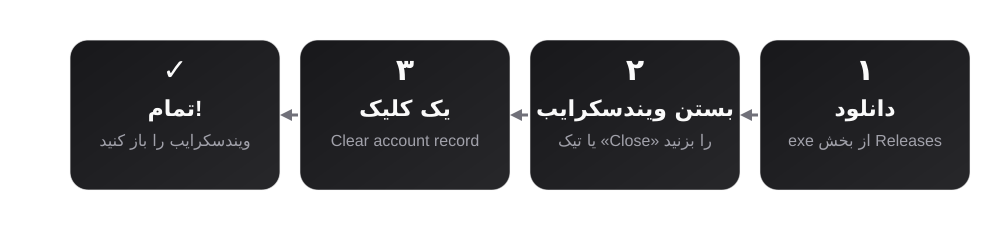
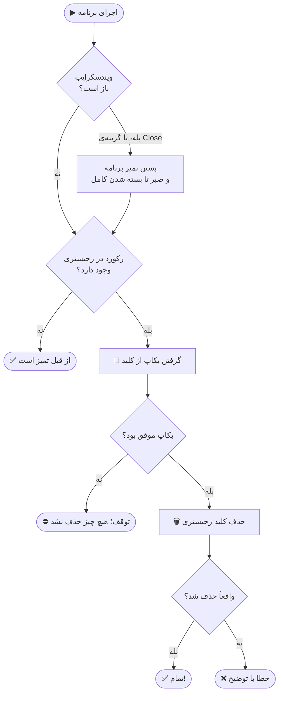
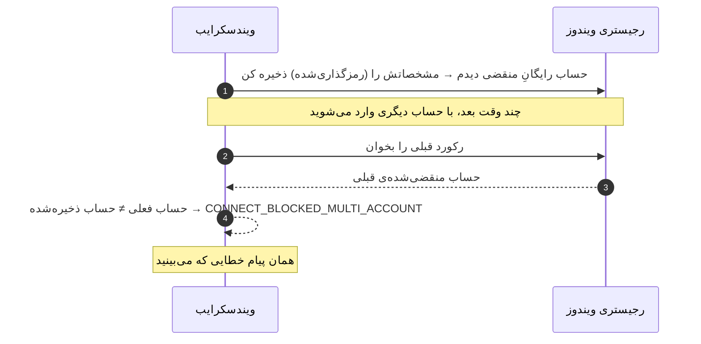

<p align="center">
  
</p>

<p align="center">
  <a href="../../releases/latest"></a>
</p>

<p align="center">
  
  
  
  
  
  
  
</p>

<p align="center">
  <a href="README.md">English</a> &nbsp;·&nbsp; <b>فارسی</b>
</p>

<div dir="rtl">

## ✨ این ابزار چیه؟

اگه موقع وصل‌شدن به **ویندسکرایب (Windscribe)** این پیام رو می‌بینی:

> ❌ _Your original account `xxxx` has expired._
> _Creating multiple accounts to bypass free tier limitations is prohibited._

مشکل از رمز یا اینترنتت **نیست**. برنامه‌ی ویندسکرایب یه **رکورد محلی** روی همین کامپیوتر خودت ذخیره کرده (توی رجیستری ویندوز) و بر اساس اون جلوی اتصال رو می‌گیره.

این ابزار همون رکورد رو **بکاپ می‌گیره و پاک می‌کنه**. همین. 🎯

|     |                                                                                        |
| --- | -------------------------------------------------------------------------------------- |
| 🖱️  | یک پنجره‌ی ساده؛ بدون نصب، بدون دردسر                                                  |
| 💾  | قبل از حذف، خودکار بکاپ می‌گیره                                                        |
| ↩️  | با یک کلیک می‌تونی بکاپ رو برگردونی                                                    |
| 🔒  | فقط **یک کلید** از رجیستری خودت رو دست می‌زنه؛ اینترنت نمی‌خواد، دسترسی Admin نمی‌خواد |
| 🧪  | حالت آزمایشی (`--dry-run`) که چیزی رو تغییر نمی‌ده                                     |

> [!IMPORTANT]
> این ابزار فقط رکورد **روی کامپیوتر خودت** رو پاک می‌کنه. هیچ تغییری سمت سرور ویندسکرایب ایجاد نمی‌کنه و اشتراک هم فعال یا تمدید نمی‌کنه.

---

## 🚀 آموزش ۳ مرحله‌ای (ساده‌ترین روش)

</div>

<p align="center">
  
</p>

<div dir="rtl">

### مرحله ۱ — دانلود

1. برو به صفحه‌ی **[Releases](../../releases/latest)**.
2. فایل **`AccountRecordCleaner.exe`** رو دانلود کن (همونی که اسمش `-cli` نداره).

### مرحله ۲ — اجرا

1. ویندسکرایب رو ببند (یا تیک «Close Windscribe first» رو بزن تا خودش ببنده).
2. روی `AccountRecordCleaner.exe` **دابل‌کلیک** کن.

> [!NOTE]
> ویندوز ممکنه بنر آبی **«Windows protected your PC»** نشون بده، چون برنامه امضای دیجیتال پولی نداره.
> روی **More info** و بعد **Run anyway** بزن. سورس کامل همین‌جا باز و قابل بررسیه و exe با GitHub Actions ساخته می‌شه (پایین‌تر توضیح دادم چطور اصالتش رو چک کنی).

### مرحله ۳ — یک کلیک

1. دکمه‌ی **Clear account record** رو بزن و تأیید کن.
2. وقتی نوشت `Record deleted` ✅ کارت تمومه.
3. ویندسکرایب رو دوباره باز کن و وصل شو.

> [!TIP]
> اگه چیزی خراب شد، دکمه‌ی **Restore latest backup** آخرین بکاپ رو برمی‌گردونه.

---

## 🧠 پشت صحنه چه اتفاقی می‌افته؟

</div>



<div dir="rtl">

### رکورد دقیقاً کجاست؟

</div>

```text
HKEY_CURRENT_USER\Software\Microsoft\Windows\CurrentVersion\NetControlPort
    Version   REG_DWORD    0x1
    State     REG_BINARY   <داده‌ی رمزگذاری‌شده>
```

<div dir="rtl">

اسم این کلید عمداً شبیه کلیدهای خود ویندوز انتخاب شده؛ اما فقط همین یک کلید توسط این ابزار حذف می‌شه.

### چرا ویندسکرایب جلوی اتصال رو می‌گیره؟

</div>



<div dir="rtl">

---

## 🛠️ حالت پیشرفته (خط فرمان)

اگه با ترمینال راحتی، فایل **`AccountRecordCleaner-cli.exe`** رو بگیر:

</div>

```powershell
AccountRecordCleaner-cli.exe --kill-client      # بستن ویندسکرایب + بکاپ + حذف
AccountRecordCleaner-cli.exe --dry-run          # فقط نشون بده چی می‌شه، چیزی تغییر نکنه
AccountRecordCleaner-cli.exe --restore          # برگردوندن جدیدترین بکاپ
AccountRecordCleaner-cli.exe --list-backups     # لیست بکاپ‌ها
```

<div dir="rtl">

| گزینه              | کاربرد                                                                           |
| ------------------ | -------------------------------------------------------------------------------- |
| `--kill-client`    | اول به‌صورت تمیز می‌بنده، فقط در صورت نیاز اجباری، و صبر می‌کنه تا کامل بسته بشه |
| `--no-backup`      | بدون بکاپ حذف کن (پیشنهاد نمی‌شه)                                                |
| `--backup-dir DIR` | مسیر دلخواه برای بکاپ‌ها                                                         |
| `--dry-run`        | فقط گزارش بده                                                                    |
| `--restore [FILE]` | یک بکاپ رو برگردون (پیش‌فرض: جدیدترین)                                           |
| `--list-backups`   | لیست بکاپ‌ها                                                                     |

**کد خروج:** `0` موفق · `1` خطا (بکاپ، حذف یا بستن برنامه) · `2` ویندوز نیست.

### 💾 بکاپ‌ها کجان؟

کنار خود برنامه، توی پوشه‌ی `backups` با اسمی مثل `netcontrolport-20261029-004500.reg`.
اگه اون پوشه قابل نوشتن نباشه، توی `%LOCALAPPDATA%\AccountRecordCleaner\backups` ذخیره می‌شه.
بکاپ‌ها **هیچ‌وقت روی هم نوشته نمی‌شن**. اگه بکاپ ساخته نشه، **چیزی حذف نمی‌شه**.

> [!WARNING]
> فایل بکاپ شامل رکورد رمزگذاری‌شده‌ی حساب توئه. جایی آپلودش نکن.

---

## ❓ سوالات متداول و رفع مشکل

<details>
<summary><b>بعد از پاک‌کردن، دوباره همون خطا اومد!</b></summary>

ویندسکرایب هر بار که دوباره یه حساب منقضی ببینه، رکورد رو از نو می‌سازه. پس ممکنه خطا برگرده. موقع اجرا ویندسکرایب رو **کامل ببند** (گزینه‌ی Close رو فعال بذار) و بعد از پاک‌کردن اجراش کن. اگه محدودیت سمت سرور اعمال شده باشه، این ابزار روش اثری نداره.

</details>

<details>
<summary><b>نوشت «No record found - already clean»</b></summary>

یعنی رکوردی برای این حساب کاربری ویندوز پیدا نشده؛ یا قبلاً پاک شده، یا ویندسکرایب با حساب کاربری دیگه‌ای استفاده شده. اگه برنامه رو با «Run as administrator» و یک حساب Admin دیگه اجرا کردی، به‌جاش با حساب کاربری عادی خودت و بدون Admin اجراش کن.

</details>

<details>
<summary><b>ویندوز می‌گه برنامه ناشناخته‌ست (SmartScreen)</b></summary>

More info ← Run anyway. اگه نگرانی، چک‌سام فایل رو با `SHA256SUMS.txt` مقایسه کن:

```powershell
Get-FileHash .\AccountRecordCleaner.exe -Algorithm SHA256
```

</details>

<details>
<summary><b>آنتی‌ویروس هشدار داد</b></summary>

برنامه‌هایی که با PyInstaller ساخته می‌شن گاهی هشدار الکی (false positive) می‌گیرن. سورس کامل و workflowی که exe رو می‌سازه توی همین مخزنه؛ می‌تونی خودت هم بسازیش (پایین‌تر).

</details>

<details>
<summary><b>می‌خوام بکاپ رو دستی برگردونم</b></summary>

روی فایل `.reg` دابل‌کلیک کن و تأیید کن، یا:

```powershell
reg import .\backups\netcontrolport-20261029-004500.reg
```

</details>

---

## 🔍 شفافیت و امنیت

- ✅ **سورس باز** و کوچک؛ فقط یک کلید زیر `HKCU` رو می‌خونه/حذف می‌کنه.
- ✅ **بدون اینترنت**؛ برنامه هیچ داده‌ای نمی‌فرسته.
- ✅ فایل exe با **GitHub Actions** از همین سورس ساخته می‌شه (`.github/workflows/release.yml`) و در Release فایل `SHA256SUMS.txt` هست تا اصالتش رو چک کنی.
- ✅ ۳۰+ تست خودکار روی منطق برنامه.

---

## 🧑‍💻 برای برنامه‌نویس‌ها

**اجرا از سورس:**

</div>

```powershell
python -m pip install -e .
python -m account_cleaner --kill-client
python -m account_cleaner.gui
```

<div dir="rtl">

**ساخت exe:**

</div>

```powershell
python -m pip install -e ".[dev]"
python packaging/build.py        # خروجی در پوشه‌ی dist
```

<div dir="rtl">

**انتشار نسخه‌ی جدید:** یک تگ بزن و پوش کن؛ بقیه‌اش خودکاره 🤖

</div>

```bash
git tag v1.0.1
git push origin v1.0.1
```

<div dir="rtl">

```text
account_cleaner/   منطق اصلی، دسترسی به رجیستری، مدیریت پروسه، CLI و GUI
tests/             تست‌ها
packaging/         ساخت exe با PyInstaller
assets/            بنر و تصاویر متحرک
.github/workflows/ CI، ساخت exe و انتشار
```

---

## ⚠️ محدودیت‌ها

- **دائمی نیست:** اگه ویندسکرایب دوباره حساب منقضی ببینه، کلید رو از نو می‌سازه.
- **فقط محلی:** وضعیت سمت سرور ویندسکرایب تغییر نمی‌کنه.
- **فقط ویندوز:** در macOS و لینوکس رکورد جور دیگه‌ای ذخیره می‌شه.

## 📜 سلب مسئولیت

این پروژه برای اهداف **پژوهشی و آموزشی** منتشر شده و نشون می‌ده یک مکانیزم تشخیص سمت-کلاینت چطور روی دستگاه خودت داده ذخیره می‌کنه. رعایت شرایط استفاده (ToS) ویندسکرایب با خودته. این پروژه هیچ ارتباط یا تأییدی از طرف Windscribe نداره و بدون هیچ ضمانتیه؛ مسئولیت استفاده با خودته.

## ⭐ حمایت

اگه به کارت اومد، یه ⭐ به مخزن بده و دوستانت رو هم باخبر کن.

</div>

<p align="center">
  <a href="https://star-history.com/#imhamiddev/vpn-bypass&Date">
    
  </a>
</p>

<p align="center"><sub>لایسنس MIT · ساخته‌شده با ❤️</sub></p>
