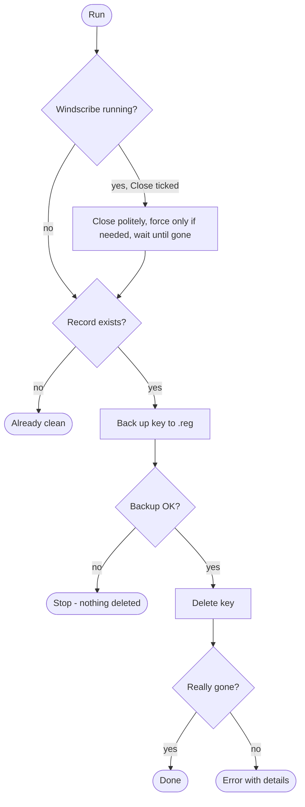

<p align="center">
  
</p>

<p align="center">
  <a href="../../releases/latest"></a>
</p>

<p align="center">
  
  
  
  
  
  
</p>

<p align="center"><b>English</b> &nbsp;·&nbsp; <a href="README.fa.md">فارسی</a></p>

## What is this?

If connecting with **Windscribe** shows

> *Your original account `xxxx` has expired. Creating multiple accounts to bypass free tier limitations is prohibited.*

the cause is not your password or network. The Windscribe Windows client keeps a **local record**
of an expired free account in the registry and blocks connections based on it. This tool **backs up
and deletes that record**.

- 🖱️ Small window, nothing to install
- 💾 Automatic `.reg` backup before deleting, one-click restore
- 🔒 Touches **one key** under `HKCU`; no admin rights, no network access
- 🧪 `--dry-run` mode that changes nothing

> [!IMPORTANT]
> Local cleanup only. Nothing changes on Windscribe's servers, and no subscription is granted or extended.

## Quick start

<p align="center"></p>

1. Download **`AccountRecordCleaner.exe`** from **[Releases](../../releases/latest)**.
2. Close Windscribe (or keep "Close Windscribe first" ticked) and double-click the exe.
3. Press **Clear account record**, confirm, then reopen Windscribe.

> [!NOTE]
> Windows SmartScreen may show "Windows protected your PC" because the exe is not code-signed.
> Click **More info → Run anyway**. Verify the download against `SHA256SUMS.txt`:
> `Get-FileHash .\AccountRecordCleaner.exe -Algorithm SHA256`

Made a mistake? **Restore latest backup** puts the record back.

## How it works



The record lives here (named to look like a stock Windows key):

```text
HKCU\Software\Microsoft\Windows\CurrentVersion\NetControlPort
    Version  REG_DWORD    0x1
    State    REG_BINARY   <encrypted blob>
```

## Command line

`AccountRecordCleaner-cli.exe` is the console build (the other exe is the window):

```powershell
AccountRecordCleaner-cli.exe --kill-client      # close Windscribe, back up, delete
AccountRecordCleaner-cli.exe --dry-run          # report only
AccountRecordCleaner-cli.exe --restore          # re-import the newest backup
AccountRecordCleaner-cli.exe --list-backups
```

| Option | Meaning |
|---|---|
| `--kill-client` | Ask Windscribe to close, force only if needed, wait until it is gone |
| `--no-backup` | Delete without a backup (not recommended) |
| `--backup-dir DIR` | Where backups are written / read |
| `--dry-run` | Report only |
| `--restore [FILE]` | Import a backup (default: newest) instead of cleaning |
| `--list-backups` | List backups |

Exit codes: `0` success · `1` failure (backup, delete, or closing the client) · `2` not Windows.

Backups go to `backups/` next to the program (or `%LOCALAPPDATA%\AccountRecordCleaner\backups`
if that is not writable), are never overwritten, and if one cannot be written **nothing is deleted**.

> [!WARNING]
> A backup contains your encrypted account record - never upload or commit one.

## Transparency

- Open source, small, reads/deletes only the key above
- No network code; the program sends nothing anywhere
- Executables are built by GitHub Actions from this source (`.github/workflows/release.yml`), with checksums in each release
- 30+ automated tests

## Development

```powershell
python -m pip install -e ".[dev]"
python -m pytest -q
python -m account_cleaner --dry-run      # CLI from source
python -m account_cleaner.gui            # window from source
python packaging/build.py                # build the exes (Windows)
```

Release: `git tag v1.0.1 && git push origin v1.0.1` - the workflow builds, tests and publishes.

```text
account_cleaner/   core logic, registry backend, process handling, CLI, GUI
tests/             unit tests + opt-in real-registry test
packaging/         PyInstaller entry points and build script
assets/            banner and diagrams
.github/workflows/ CI, exe build, release
```

## Limitations

- **Not permanent** - the client recreates the key if it sees an expired account again.
- **Local only** - server-side restrictions are not affected.
- **Windows only** - macOS and Linux store the record differently.

## Disclaimer

Published for research and educational purposes: documenting how a client-side detection mechanism
stores state on your own machine and how to inspect and reset it. Complying with Windscribe's Terms
of Service is your responsibility. Not affiliated with or endorsed by Windscribe. No warranty; use
at your own risk.

## License

MIT - see [LICENSE](LICENSE).
